# Born2beRoot_Guide

A complete guide to completing the **Born2beRoot** system administration project from **42 School**.

This project introduces **virtualization**, **Linux server installation**, **system security**, and **basic system administration**.

The goal is to configure a **secure Debian server inside a virtual machine** while following strict security rules.

---

# Table of Contents

- [Project Overview](#project-overview)
- [Requirements](#requirements)
- [Tools Used](#tools-used)
- [Step 1 — Create the Virtual Machine](#step-1--create-the-virtual-machine)
- [Step 2 — Install Debian](#step-2--install-debian)
- [Step 3 — Disk Partitioning](#step-3--disk-partitioning)
- [Step 4 — User and Group Management](#step-4--user-and-group-management)
- [Step 5 — Configure Sudo](#step-5--configure-sudo)
- [Step 6 — Configure SSH](#step-6--configure-ssh)
- [Step 7 — Configure Firewall](#step-7--configure-firewall)
- [Step 8 — Password Policy](#step-8--password-policy)
- [Step 9 — Monitoring Script](#step-9--monitoring-script)
- [Step 10 — Cron Job](#step-10--cron-job)
- [Testing During Evaluation](#testing-during-evaluation)
- [Useful Commands](#useful-commands)

---

# Project Overview

Born2beRoot teaches the fundamentals of:

- Virtual Machines
- Linux installation
- User and permission management
- SSH configuration
- Firewall configuration
- Password policies
- System monitoring
- Security best practices

The project requires creating a **secure Linux server environment from scratch**.

---

# Requirements

Your server must:

- Run **Debian**
- Have **no graphical interface**
- Use **encrypted partitions**
- Run **SSH on port 4242**
- Disable **root SSH login**
- Configure **UFW firewall**
- Implement **strict password rules**
- Configure **sudo logging**
- Run a **monitoring script every 10 minutes**

---

# Tools Used

Virtualization:

- VirtualBox  
- UTM (for macOS)

Operating system:

- Debian

Linux utilities:

- `sudo`
- `ssh`
- `ufw`
- `cron`
- `lsblk`
- `hostnamectl`

---

# Step 1 - Create the Virtual Machine

1- Open **VirtualBox** and create a new VM.

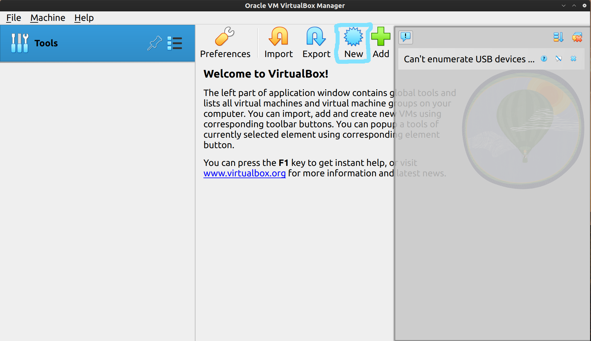
---
**Configuration:**   
    Name: Born2beRoot  
    Type: Linux  
    Version: Debian (64-bit)  

---

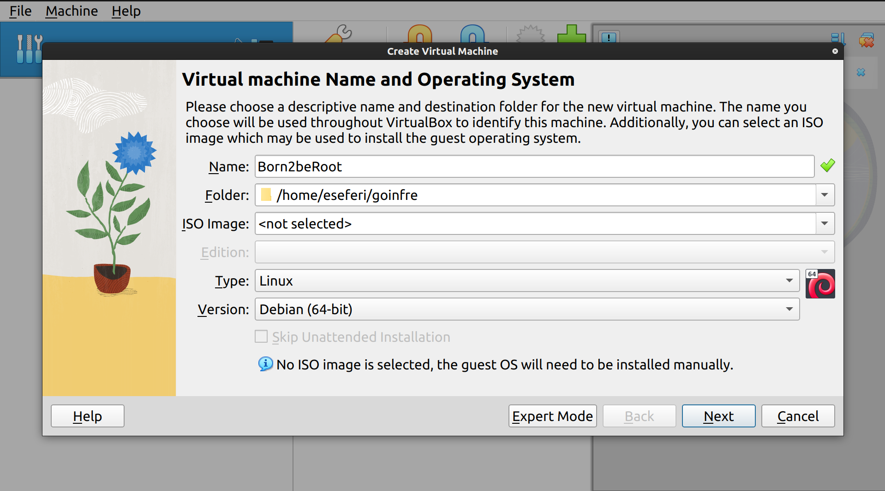

---

**Configuration:**    
    Memory: 1024 MB  
    Disk: 30 GB (VDI)

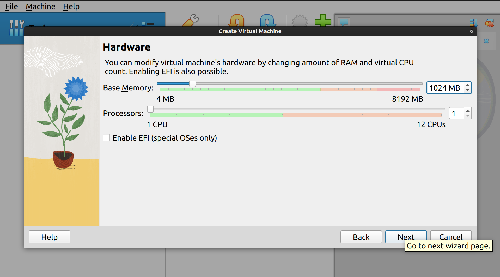
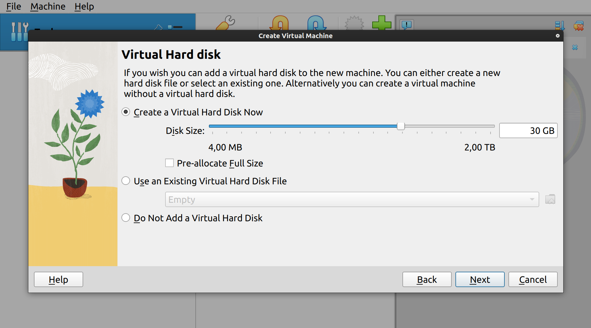
---

2- Press finish

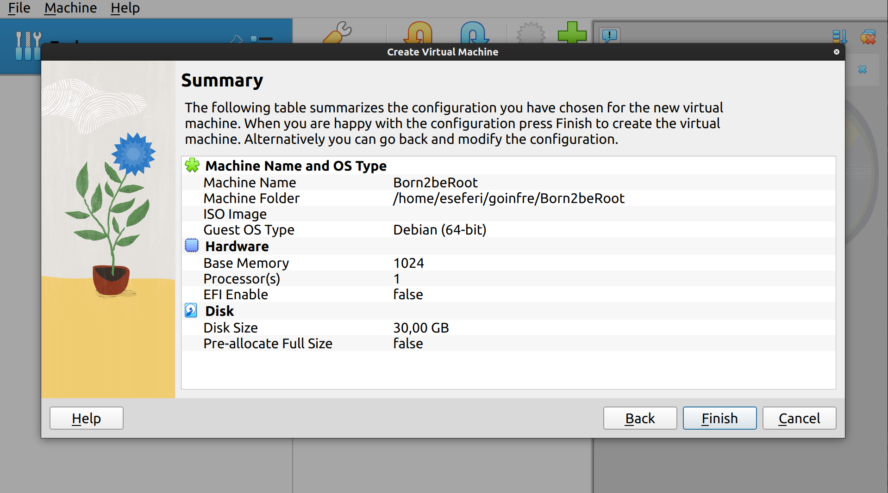

---

# Step 2 - Mount iso file and Start VM

After pressing finished you should see your new Vm created like below. You should go to settings to start with the next step of mounting an ISO file.  
(if debian isn't installed go to : https://www.debian.org/distrib/).

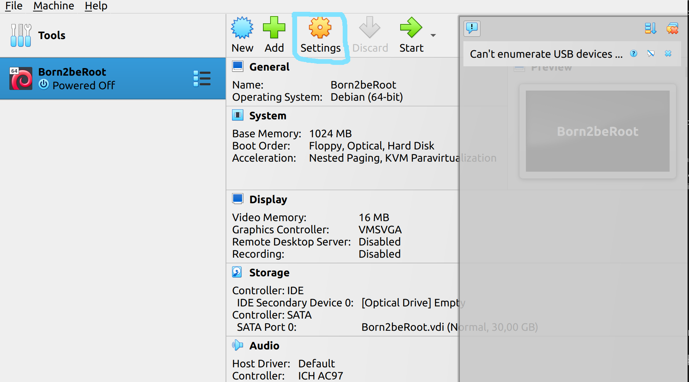
---

1- Controller: Under the "Controller: IDE" or "Controller: SATA" section (depending on your VM's configuration), you'll find an empty optical drive (usually labeled "Empty"). Click on the optical drive. Attributes: In the attributes section to the right, you'll see a small disk icon next to "IDE Secondary Master" or "SATA Port 1." Click on the disk icon. Choose a Disk File: In the dropdown menu, select "Choose a disk file..." Navigate to the location of the ISO file on your computer and select it.

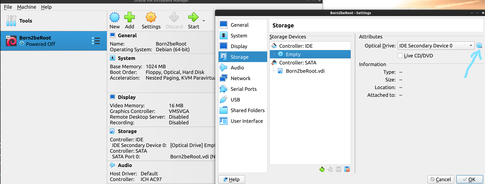

2- After choosing Debian ISO image that we dowloaded in the beginning you should have the same results as below, and then type ok.

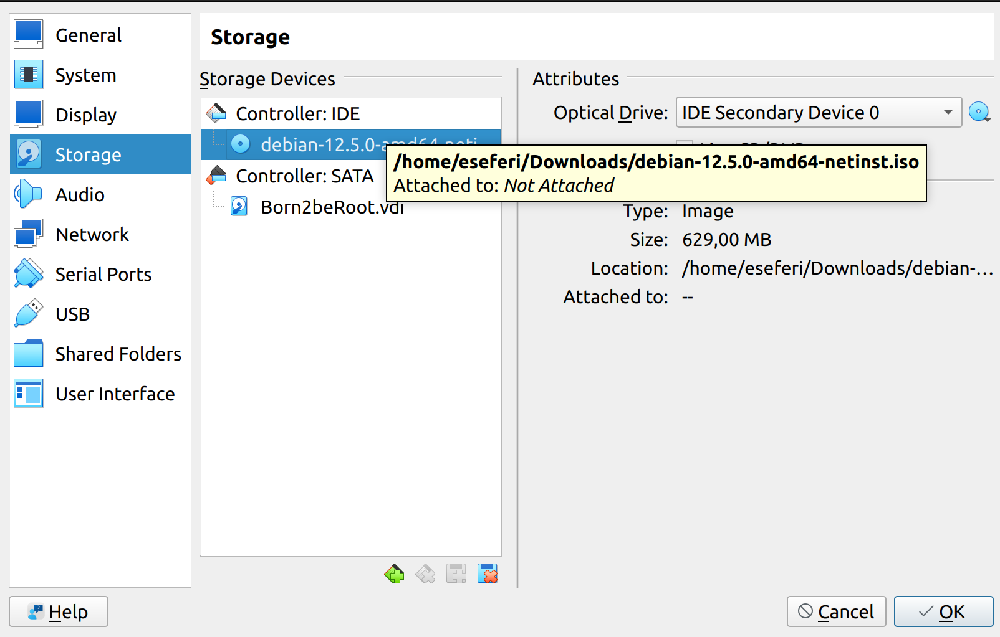

3- Press **Start**

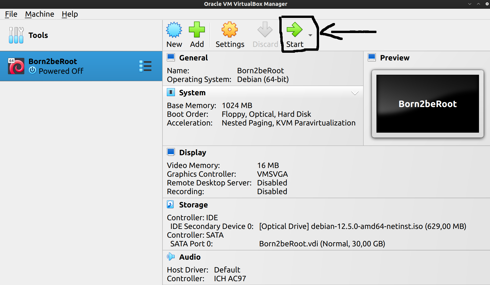

# Step 3 - Install Debian
**1- Setting up the languange, time zone, keyboard layout**

---
1- Choose the install option since we will use it without Graphical Interface.

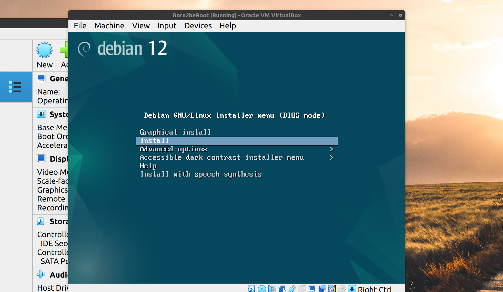

2- Let's choose English

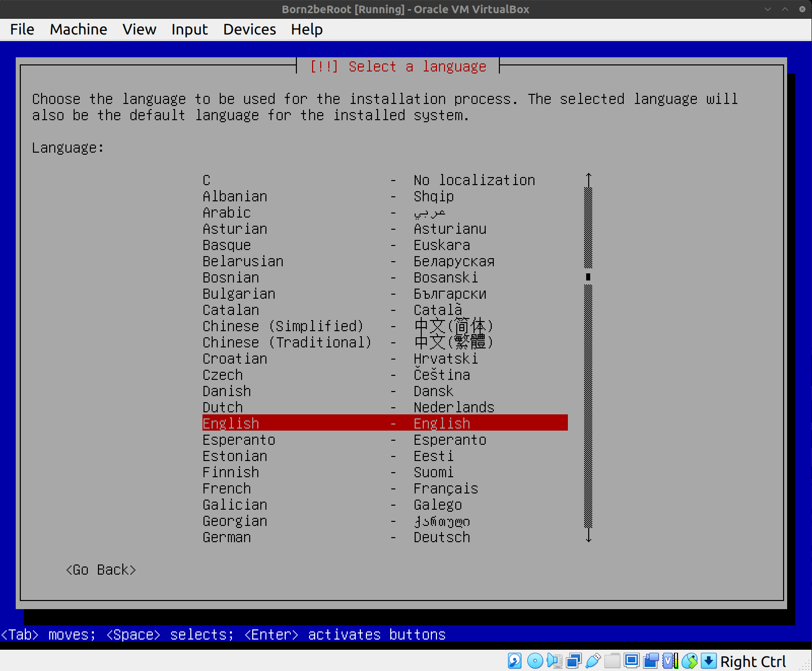

3- Now we should enter our country, territory or area. Since I'm in Morocco I will put Other.

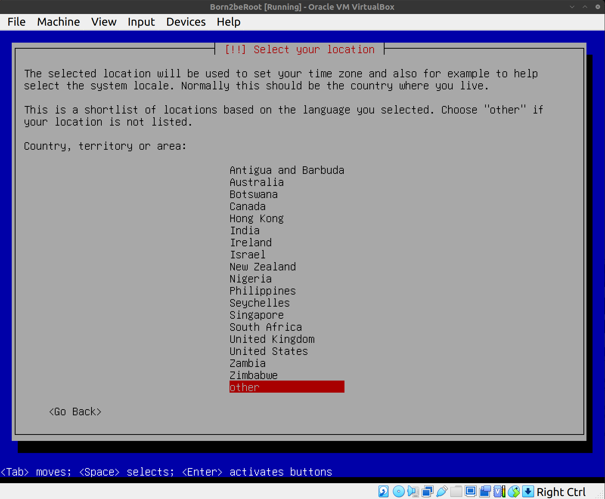

4- Configuring locales: I will go with United States

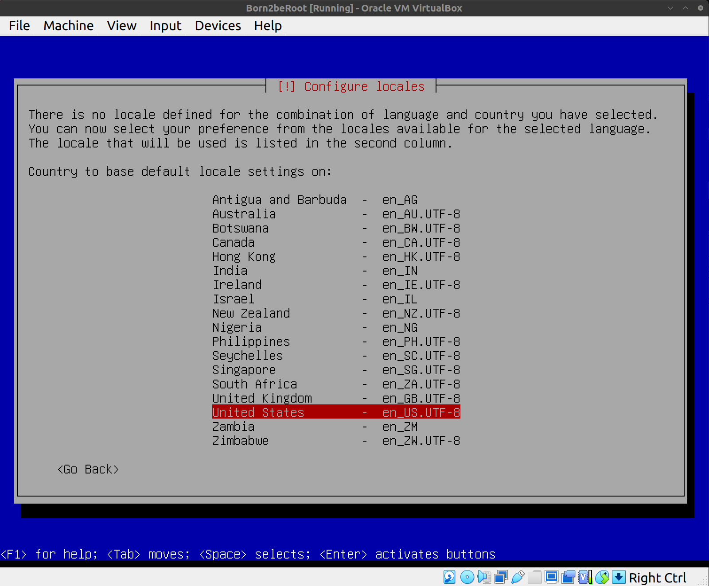

5- It is important to select American English as the keyboard configuration, otherwise we will have the keys linked incorrectly.

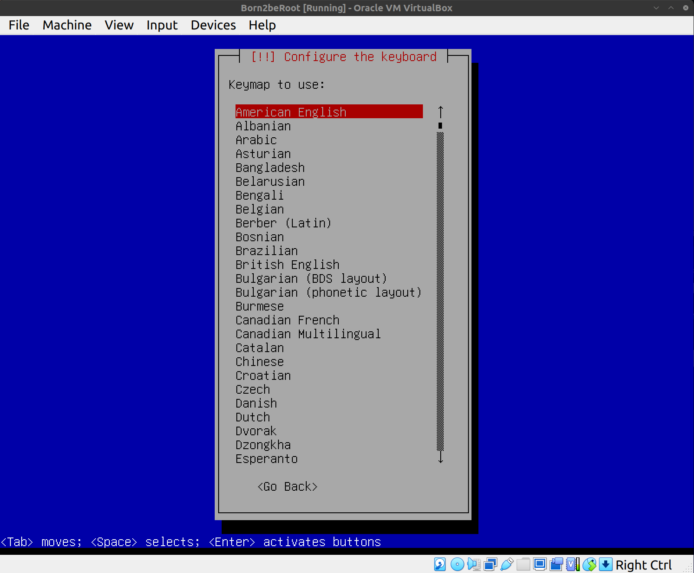

6- Finally, this window below should appear;

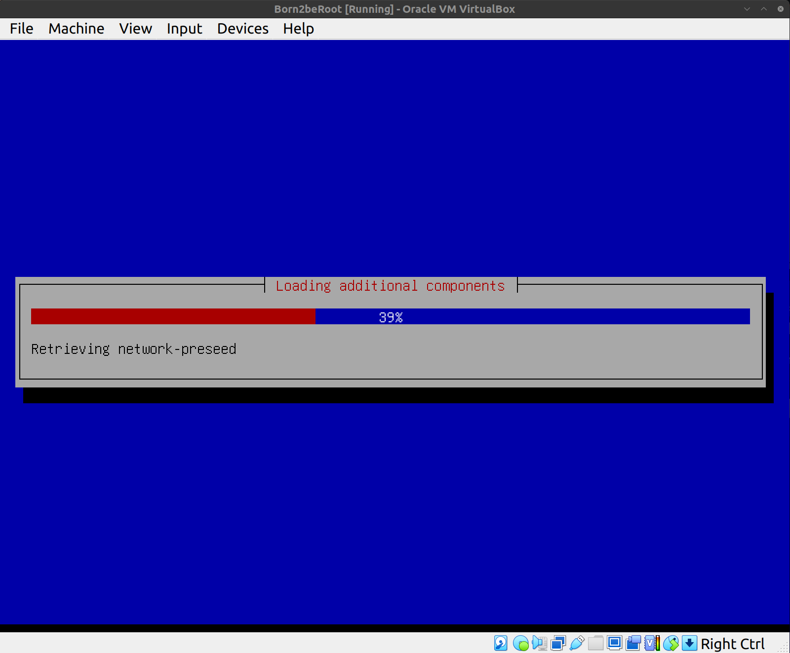

Important installer settings:

```
Hostname: login42
Domain: leave empty
```

Choose **standard system utilities only** (no desktop environment).

---

### Image Placeholder

```
images/debian_installer_menu.png
```

**Description**

> Debian installer menu showing:
> - Install
> - Graphical Install

---

# Step 3 — Disk Partitioning

Choose:

```
Guided - use entire disk
```

Then select:

```
Separate /home partition
```

Enable **disk encryption**.

Expected partition structure:

```
/boot
/
/home
swap
```

---

### Image Placeholder

```
images/partition_layout.png
```

**Description**

> Debian partition layout screen showing encrypted LVM with:
> - /boot
> - /
> - /home
> - swap

---

# Step 4 — User and Group Management

Create your user during installation.

Example:

```
username: login
```

Create required group:

```bash
sudo groupadd user42
```

Add user to the group:

```bash
sudo usermod -aG user42 login
```

Verify:

```bash
groups login
```

---

# Step 5 — Configure Sudo

Install sudo if needed:

```bash
sudo apt install sudo
```

Add user to sudo group:

```bash
sudo usermod -aG sudo login
```

Edit sudo configuration:

```bash
sudo visudo
```

Add rules:

```
Defaults passwd_tries=3
Defaults badpass_message="Wrong password"
Defaults logfile="/var/log/sudo/sudo.log"
Defaults requiretty
```

Create log directory:

```bash
sudo mkdir /var/log/sudo
```

---

### Image Placeholder

```
images/sudo_log.png
```

**Description**

> Terminal displaying `/var/log/sudo/sudo.log` with recorded commands.

---

# Step 6 — Configure SSH

Install SSH server:

```bash
sudo apt install openssh-server
```

Edit configuration:

```bash
sudo nano /etc/ssh/sshd_config
```

Change:

```
Port 4242
PermitRootLogin no
```

Restart SSH:

```bash
sudo service ssh restart
```

Check status:

```bash
sudo service ssh status
```

---

### Image Placeholder

```
images/ssh_config.png
```

**Description**

> `sshd_config` file showing:
> - Port 4242
> - PermitRootLogin no

---

# Step 7 — Configure Firewall

Install UFW:

```bash
sudo apt install ufw
```

Enable firewall:

```bash
sudo ufw enable
```

Allow SSH port:

```bash
sudo ufw allow 4242
```

Check firewall:

```bash
sudo ufw status
```

Expected output:

```
4242/tcp ALLOW Anywhere
```

---

### Image Placeholder

```
images/ufw_status.png
```

**Description**

> Terminal output of `ufw status` showing port **4242 allowed**.

---

# Step 8 — Password Policy

Install password quality module:

```bash
sudo apt install libpam-pwquality
```

Edit:

```
/etc/security/pwquality.conf
```

Example rules:

```
minlen = 10
ucredit = -1
lcredit = -1
dcredit = -1
maxrepeat = 3
difok = 7
```

Modify login defaults:

```
/etc/login.defs
```

```
PASS_MAX_DAYS 30
PASS_MIN_DAYS 2
PASS_WARN_AGE 7
```

---

### Image Placeholder

```
images/password_policy.png
```

**Description**

> `pwquality.conf` displaying password rules.

---

# Step 9 — Monitoring Script

Create script:

```bash
sudo nano monitoring.sh
```

Example script:

```bash
#!/bin/bash

arch=$(uname -a)
cpu=$(grep "physical id" /proc/cpuinfo | sort | uniq | wc -l)
vCPU=$(nproc)
mem=$(free -m | awk '$1=="Mem:" {printf "%d/%dMB (%.2f%%)", $3,$2,$3*100/$2 }')

echo "Architecture: $arch"
echo "CPU physical: $cpu"
echo "vCPU: $vCPU"
echo "Memory Usage: $mem"
```

Make executable:

```bash
chmod +x monitoring.sh
```

---

# Step 10 — Cron Job

Edit cron jobs:

```bash
crontab -e
```

Add:

```
*/10 * * * * /path/to/monitoring.sh
```

This runs the script **every 10 minutes**.

---

### Image Placeholder

```
images/cron_job.png
```

**Description**

> Screenshot of `crontab -e` showing the monitoring script scheduled every 10 minutes.

---

# Testing During Evaluation

Commands evaluators may ask you to run:

### System information

```bash
uname -a
```

### Partitions

```bash
lsblk
```

### Groups

```bash
getent group user42
```

### SSH

```bash
sudo service ssh status
```

### Firewall

```bash
sudo ufw status
```

### Password policy

```bash
sudo chage -l username
```

### Cron jobs

```bash
crontab -l
```

---

# Useful Commands

Update system:

```bash
sudo apt update && sudo apt upgrade
```

Disk usage:

```bash
df -h
```

Memory usage:

```bash
free -m
```

CPU info:

```bash
lscpu
```

Network interfaces:

```bash
ip a
```

---

# Summary

This project teaches essential Linux administration concepts:

- Virtual machines
- Secure server configuration
- User and permission management
- Firewall and SSH security
- Password policies
- System monitoring

It forms the **foundation of Linux system administration**.


